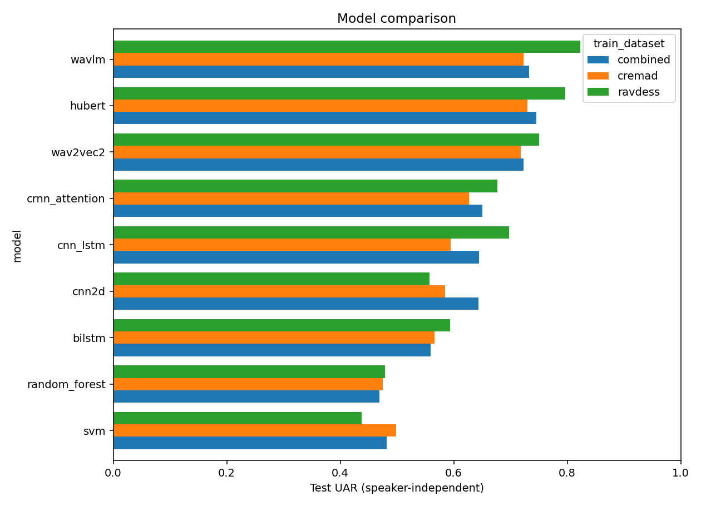
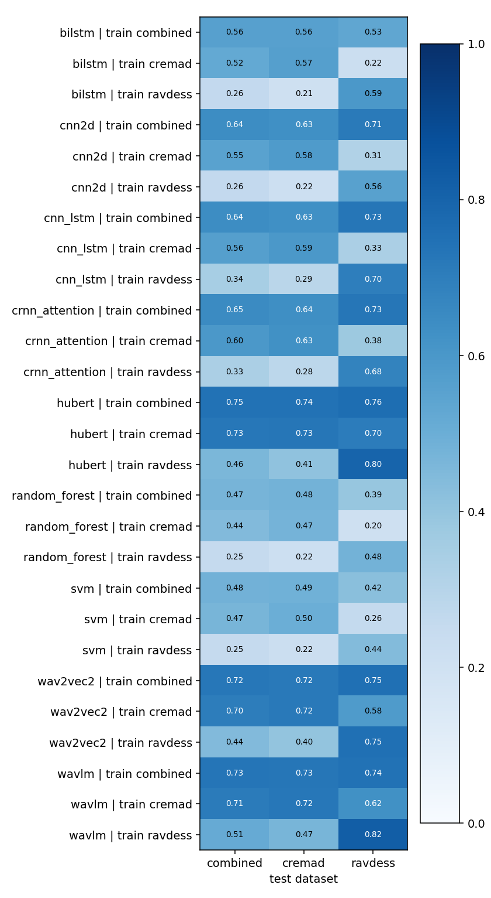
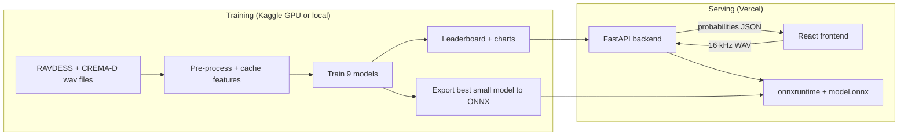

# Speech Emotion Recognition

[](https://github.com/Sanjeev2004/Speech-Emotion-Recognization/actions/workflows/ci.yml)
[](LICENSE)
[](https://ser-frontend-beta.vercel.app)
[-0.650-informational)](reports/leaderboard.md)

Detect the emotion in a voice clip: **neutral, happy, sad, angry, fear or disgust**.

This project trains and compares machine learning models on two public emotional-speech datasets (9 architectures in the registry). It serves the best small model through a FastAPI backend and a React web app. Training runs on a free Kaggle GPU; the app runs on Vercel's free tier (or locally via Docker Compose).

**Live demo:** https://ser-frontend-beta.vercel.app  
**API docs (Swagger):** https://ser-backend-bice.vercel.app/docs  
**Resume / interview kit:** [docs/RESUME.md](docs/RESUME.md)

### Quick demo (screenshot)

| Analyze | Model comparison |
|---|---|
| Record or upload speech → six emotion probabilities | Leaderboard, confusion matrix, cross-dataset table |

*(Tip for your portfolio: record a 20–40 s screen capture of Analyze → Result → Comparison and drop the GIF next to this section.)*

---

## Table of contents

1. [What the project does](#1-what-the-project-does)
2. [Results](#2-results)
3. [Key concepts in plain words](#3-key-concepts-in-plain-words)
4. [System architecture](#4-system-architecture)
5. [Repository structure](#5-repository-structure)
6. [Datasets](#6-datasets)
7. [Audio pre-processing and features](#7-audio-pre-processing-and-features)
8. [Models](#8-models)
9. [Training setup](#9-training-setup)
10. [Evaluation method](#10-evaluation-method)
11. [What changed from the original notebook](#11-what-changed-from-the-original-notebook)
12. [Getting started (local)](#12-getting-started-local)
13. [Training all models on Kaggle](#13-training-all-models-on-kaggle)
14. [Command reference](#14-command-reference)
15. [Backend API reference](#15-backend-api-reference)
16. [Frontend](#16-frontend)
17. [Deployment](#17-deployment)
18. [Testing](#18-testing)
19. [Limitations and future work](#19-limitations-and-future-work)
20. [Troubleshooting](#20-troubleshooting)
21. [Credits and dataset licences](#21-credits-and-dataset-licences)

---

## 1. What the project does

| Part | What it does |
|---|---|
| **ML pipeline** (`ml/`) | Reads RAVDESS and CREMA-D, splits the data by speaker, extracts features once and caches them, trains 9 models, evaluates each one on every test set and builds a leaderboard with charts. It also exports the chosen model to ONNX. |
| **Backend** (`backend/`) | A FastAPI server. It accepts an audio file, turns it into a spectrogram, runs the ONNX model and returns a probability for each emotion. |
| **Frontend** (`frontend/`) | A React app. You can record from the microphone or upload a file and see the prediction. It also shows the model comparison and explains how the system works. |

The user flow:

1. Open the website and record a sentence (or upload a file).
2. The browser converts the audio to a 16 kHz mono WAV file and sends it to the API.
3. The API predicts the emotion and returns all 6 probabilities.
4. The website shows the top emotion, its confidence and a bar for each emotion.

---

## 2. Results

**Full sweep on a Kaggle T4 GPU:** all 9 models, each trained on RAVDESS, CREMA-D and both combined, then tested on every test set. Test sets are speaker-independent: the actors in them never appear in training. Random guessing among 6 emotions scores about 16.7%.

**UAR** (unweighted average recall) is the main metric: the mean of the per-emotion recalls. It is fairer than plain accuracy because the emotions are not equally common.

### Trained and tested on combined (RAVDESS + CREMA-D, 1,323 test clips)

| Rank | Model | Accuracy | UAR | Macro-F1 | Parameters |
|---|---|---|---|---|---|
| 1 | HuBERT | 0.743 | **0.746** | 0.743 | 94.57 M |
| 2 | WavLM | 0.735 | 0.732 | 0.736 | 94.58 M |
| 3 | wav2vec2 | 0.721 | 0.723 | 0.721 | 94.57 M |
| 4 | CRNN + attention (deployed) | 0.647 | 0.650 | 0.646 | 0.75 M |
| 5 | CNN-LSTM | 0.641 | 0.644 | 0.641 | 1.34 M |
| 6 | CNN (2D) | 0.640 | 0.643 | 0.637 | 1.17 M |
| 7 | BiLSTM + attention | 0.559 | 0.559 | 0.556 | 0.63 M |
| 8 | SVM (RBF) | 0.484 | 0.482 | 0.482 | - |
| 9 | Random Forest | 0.468 | 0.469 | 0.453 | - |

### Trained and tested on CREMA-D

| Rank | Model | Accuracy | UAR | Macro-F1 | Parameters |
|---|---|---|---|---|---|
| 1 | HuBERT | 0.728 | **0.730** | 0.728 | 94.57 M |
| 2 | WavLM | 0.724 | 0.723 | 0.728 | 94.58 M |
| 3 | wav2vec2 | 0.718 | 0.718 | 0.719 | 94.57 M |
| 4 | CRNN + attention | 0.626 | 0.627 | 0.626 | 0.75 M |
| 5 | CNN-LSTM | 0.593 | 0.595 | 0.591 | 1.34 M |
| 6 | CNN (2D) | 0.584 | 0.585 | 0.583 | 1.17 M |
| 7 | BiLSTM + attention | 0.563 | 0.566 | 0.559 | 0.63 M |
| 8 | SVM (RBF) | 0.499 | 0.498 | 0.496 | - |
| 9 | Random Forest | 0.473 | 0.475 | 0.454 | - |

### Trained and tested on RAVDESS

| Rank | Model | Accuracy | UAR | Macro-F1 | Parameters |
|---|---|---|---|---|---|
| 1 | WavLM | 0.824 | **0.823** | 0.821 | 94.58 M |
| 2 | HuBERT | 0.801 | 0.797 | 0.796 | 94.57 M |
| 3 | wav2vec2 | 0.739 | 0.750 | 0.730 | 94.57 M |
| 4 | CNN-LSTM | 0.693 | 0.698 | 0.687 | 1.34 M |
| 5 | CRNN + attention | 0.665 | 0.677 | 0.648 | 0.75 M |
| 6 | BiLSTM + attention | 0.602 | 0.594 | 0.584 | 0.63 M |
| 7 | CNN (2D) | 0.562 | 0.557 | 0.531 | 1.17 M |
| 8 | Random Forest | 0.511 | 0.479 | 0.474 | - |
| 9 | SVM (RBF) | 0.472 | 0.438 | 0.424 | - |



### Cross-dataset UAR (train → test)

How well a model trained on one dataset works on another one.

| Model | combined → CREMA-D | combined → RAVDESS | CREMA-D → combined | CREMA-D → RAVDESS | RAVDESS → combined | RAVDESS → CREMA-D |
|---|---|---|---|---|---|---|
| HuBERT | **0.742** | **0.760** | **0.725** | **0.703** | 0.458 | 0.410 |
| WavLM | 0.728 | 0.745 | 0.709 | 0.625 | **0.512** | **0.467** |
| wav2vec2 | 0.717 | 0.750 | 0.700 | 0.583 | 0.443 | 0.401 |
| CRNN + attention | 0.637 | 0.729 | 0.597 | 0.375 | 0.333 | 0.281 |
| CNN-LSTM | 0.633 | 0.729 | 0.564 | 0.333 | 0.344 | 0.287 |
| CNN (2D) | 0.632 | 0.714 | 0.552 | 0.312 | 0.260 | 0.216 |
| BiLSTM + attention | 0.559 | 0.531 | 0.522 | 0.219 | 0.261 | 0.210 |
| SVM (RBF) | 0.487 | 0.422 | 0.467 | 0.255 | 0.251 | 0.220 |
| Random Forest | 0.477 | 0.391 | 0.441 | 0.203 | 0.251 | 0.215 |



### The deployed model: CRNN + attention (combined)

`crnn_attention__combined`: 0.75 M parameters, 3.0 MB ONNX, combined test UAR **0.650**, about 0.3 ms per clip on the GPU.

**Per-emotion F1 (combined test set):**

| Neutral | Happy | Sad | Angry | Fear | Disgust |
|---|---|---|---|---|---|
| 0.691 | 0.579 | 0.584 | 0.754 | 0.624 | 0.644 |

**Confusion matrix** (rows = true emotion, columns = predicted):

| true \ predicted | neutral | happy | sad | angry | fear | disgust |
|---|---|---|---|---|---|---|
| **neutral** | **135** | 11 | 10 | 7 | 17 | 3 |
| **happy** | 11 | **127** | 8 | 32 | 35 | 15 |
| **sad** | 36 | 7 | **120** | 3 | 31 | 31 |
| **angry** | 2 | 25 | 5 | **181** | 8 | 7 |
| **fear** | 10 | 21 | 27 | 5 | **152** | 13 |
| **disgust** | 14 | 20 | 13 | 24 | 16 | **141** |

**How to read this:**

- **Angry** is the easiest emotion to detect: it is loud and high-energy.
- **Happy is often confused with angry and fear.** All three are high-energy ("high arousal").
- **Sad is often confused with neutral, fear and disgust.** These are quieter, lower-energy voices.
- This pattern is well known in speech emotion research. The self-supervised models (HuBERT, WavLM, wav2vec2) understand speech better and reduce it.

Full numbers, including per-run confusion matrices, are in `reports/leaderboard.md`, `reports/leaderboard.csv` and `reports/leaderboard.json`.

### Which model should I pick?

| Goal | Pick | Why |
|---|---|---|
| **Best accuracy** | **HuBERT** (combined UAR 0.746) or **WavLM** (best on RAVDESS, UAR 0.823, and the best transfer from RAVDESS to other data) | About 95 M parameters each. They need a GPU or a large CPU machine, and are too big for a 512 MB free-tier server. |
| **Deployment on a small server** | **CRNN + attention** (UAR 0.650, 0.75 M parameters, 3 MB ONNX) | About 10 UAR points below the self-supervised models at roughly 1/125 of the size. **CNN-LSTM** (0.644) and **CNN 2D** (0.643) are close alternatives. |
| **Skip for production** | BiLSTM (0.559), SVM (0.482), Random Forest (0.469) | Useful only as baselines. |

- **Training data matters: train on the combined data.** Models trained only on RAVDESS transfer badly (UAR 0.21–0.51 on other data), because RAVDESS is small (24 actors) and acted.
- **UAR** (unweighted average recall, the mean of the per-emotion recalls) is the metric to compare. The classes are imbalanced, so accuracy alone can hide a weak emotion.

---

## 3. Key concepts in plain words

Short notes. Each term is explained the first time it matters.

| Term | Meaning |
|---|---|
| **SER** | Speech Emotion Recognition: predicting emotion from *how* something is said, not *what* is said. |
| **Sample rate (16 kHz)** | How many numbers per second describe the sound. 16,000 per second is the standard for speech models. |
| **Waveform** | The raw audio: one long list of numbers (air pressure over time). |
| **Spectrogram** | A picture of sound. x-axis = time, y-axis = frequency (pitch), brightness = loudness. |
| **Mel scale** | A frequency scale that matches human hearing: more detail at low pitches, less at high pitches. |
| **Log-mel spectrogram** | A spectrogram on the mel scale with loudness in decibels (dB). This is the main input for the deep models here: 64 mel bands x 301 time steps for a 3-second clip. |
| **MFCC** | Mel-Frequency Cepstral Coefficients: a compressed summary of the log-mel spectrogram (40 numbers per time step). A classic speech feature. |
| **Speaker-independent split** | No actor appears in more than one of train / validation / test. Without this, a model can recognise the *voice* instead of the *emotion*, and the test score looks better than reality. |
| **Validation set** | Data used during training to pick the best epoch. It is never used for the final score. |
| **Accuracy (WA)** | Share of test clips predicted correctly. |
| **UAR** | Unweighted Average Recall. Recall = "of all truly sad clips, how many did we call sad". UAR averages recall over the 6 emotions, so every emotion counts equally. It is the **main metric** in SER research. |
| **Macro-F1** | Average F1 over the 6 emotions. F1 balances precision ("when we said sad, were we right?") with recall. |
| **Confusion matrix** | A table of true vs predicted emotion. It shows which emotions get mixed up. |
| **CNN** | Convolutional Neural Network: slides small filters over an image (here, the spectrogram) to find local patterns. |
| **LSTM / GRU** | Recurrent networks: they read a sequence step by step and remember what came before. "Bi" (bidirectional) means they read forwards and backwards. |
| **Attention pooling** | The model learns a weight for each time step, so the emotional peak of a sentence counts more than silence. |
| **Self-supervised learning (SSL)** | A model is first trained on large amounts of *unlabelled* speech to understand voices in general. It is then fine-tuned on a small labelled dataset. wav2vec2, HuBERT and WavLM work like this. |
| **Fine-tuning** | Continuing to train a pre-trained model on your own task. |
| **SpecAugment** | A training trick: hide random time and frequency strips of the spectrogram, so the model cannot rely on one small detail. |
| **Class weights** | Rare emotions get a larger weight in the loss, so the model does not ignore them. |
| **Label smoothing** | Train towards 90% confidence instead of 100%. This reduces over-confidence. |
| **Early stopping** | Stop training when the validation score stops improving. |
| **ONNX** | Open Neural Network Exchange: a standard file format for trained networks. The server runs it with `onnxruntime`, so it does not need PyTorch. That makes the server much smaller and lighter on RAM. |
| **FastAPI** | A Python web framework for building APIs. |
| **CORS** | A browser security rule. The backend must explicitly allow the frontend's domain to call it. |
| **Cold start** | On free hosting the server sleeps when idle, so the first request after a pause is slower. |

---

## 4. System architecture



**Why the pieces are split this way:**

- **Training is heavy** (GPU, PyTorch, transformers), so it runs on Kaggle, and only the small `.onnx` file plus a JSON leaderboard come back.
- **Serving is light.** The backend needs only `numpy`, `scipy`, `soundfile`, `onnxruntime` and `fastapi`. In local tests it used about 215 MB of RAM.
- **The frontend does the audio decoding.** The browser decodes any format (webm from the mic, mp3, m4a) and sends a plain WAV. The server never needs `ffmpeg`.
- **Feature extraction is the same code in training and serving.** `ml/ser/audio_features.py` and `backend/app/audio_features.py` are identical (a test checks this). If the two ever differed, the model would see different numbers in production and accuracy would silently drop.

---

## 5. Repository structure

```
Speech-Emotion-Recognization/
├── README.md
├── LICENSE                          MIT
├── docker-compose.yml               One-command local demo (backend + frontend)
├── docs/RESUME.md                   Resume bullets and interview talking points
├── .github/workflows/ci.yml         Backend / frontend / ML CI
├── render.yaml                      Render config (alternative backend host)
├── reports/                         Leaderboard and charts from the latest training run
│   ├── leaderboard.md / .csv / .json
│   └── uar_by_model.png
├── notebooks/legacy/
│   └── SER_cnn_lstm_tensorflow.ipynb  The original notebook (kept for reference)
│
├── ml/                              Training code (Python package "ser")
│   ├── requirements.txt
│   ├── notebooks/train_on_kaggle.ipynb   One notebook that trains and compares everything
│   ├── ser/
│   │   ├── labels.py                The 6 emotions and dataset code -> emotion mapping
│   │   ├── datasets.py              Find files, read labels from names, speaker split
│   │   ├── audio_features.py        Pure-NumPy pre-processing + log-mel (shared with backend)
│   │   ├── features.py              Extract and cache waveforms, log-mels, statistics
│   │   ├── models/
│   │   │   ├── __init__.py          Model registry (name, type, input, defaults)
│   │   │   ├── classical.py         SVM, Random Forest
│   │   │   ├── deep.py              BiLSTM, CNN, CNN-LSTM, CRNN-attention, SpecAugment
│   │   │   └── ssl.py               wav2vec2 / HuBERT / WavLM classifier
│   │   ├── train.py                 Train one model on one dataset (with resume)
│   │   ├── run_all.py               Train every model x dataset, then compare
│   │   ├── compare.py               Build leaderboard tables and charts
│   │   ├── export_onnx.py           PyTorch -> ONNX (+ correctness check)
│   │   └── metrics.py               Accuracy, UAR, macro-F1, confusion matrix
│   └── tests/test_smoke.py          End-to-end test on synthetic audio
│
├── backend/                         FastAPI inference server
│   ├── index.py                     Entry point for Vercel
│   ├── app/
│   │   ├── main.py                  Routes: /api/health, /api/models, /api/results, /api/predict
│   │   ├── inference.py             Load ONNX models, decode audio, predict
│   │   └── audio_features.py        Copy of ml/ser/audio_features.py
│   ├── models/                      Deployed model(s) + leaderboard.json
│   ├── requirements.txt             Runtime dependencies (no PyTorch)
│   ├── requirements-dev.txt         + pytest, httpx
│   ├── .env.example
│   └── tests/                       API tests with a fake ONNX model
│
└── frontend/                        React + TypeScript + Vite
    ├── src/
    │   ├── App.tsx                  Tabs: Analyze / Model comparison / How it works
    │   ├── api.ts                   Typed API client
    │   ├── audio.ts                 Mic recording + convert anything to 16 kHz WAV
    │   ├── components/Analyze.tsx   Record / upload, model picker, result bars
    │   ├── components/Compare.tsx   Leaderboard, details table, cross-dataset table
    │   ├── components/About.tsx     Pipeline and model explanations
    │   └── styles.css               Light and dark theme
    ├── vercel.json
    └── .env.example
```

---

## 6. Datasets

| | RAVDESS | CREMA-D |
|---|---|---|
| Full name | Ryerson Audio-Visual Database of Emotional Speech and Song | Crowd-sourced Emotional Multimodal Actors Dataset |
| Speakers | 24 professional actors (12 female, 12 male) | 91 actors (48 male, 43 female), ages 20-74, several ethnicities |
| Content | 2 fixed sentences | 12 fixed sentences |
| Clips used here | 1,056 | 7,442 |
| Recording | Studio, very clean | More varied quality |
| Kaggle dataset | `uwrfkaggler/ravdess-emotional-speech-audio` | `ejlok1/cremad` |

**Label mapping.** Only the 6 emotions present in **both** datasets are used, so models can be trained on one dataset and tested on the other.

| Emotion | RAVDESS code (3rd field of file name) | CREMA-D code (3rd field) |
|---|---|---|
| neutral | `01` | `NEU` |
| happy | `03` | `HAP` |
| sad | `04` | `SAD` |
| angry | `05` | `ANG` |
| fear | `06` | `FEA` |
| disgust | `07` | `DIS` |
| *(dropped)* | `02` calm, `08` surprised | - |

How the file names are read:

- RAVDESS `03-01-05-01-02-01-12.wav` = modality `03` (audio only), channel `01` (speech), emotion `05` (angry), intensity, statement, repetition, actor `12`.
- CREMA-D `1001_DFA_ANG_XX.wav` = actor `1001`, sentence `DFA`, emotion `ANG`, level `XX`.

**Split.** For each dataset separately, the actors are shuffled with a fixed seed (42) and divided 70% / 15% / 15% into train / validation / test **by actor**. For CREMA-D this gives 63 / 14 / 14 actors (5,153 / 1,142 / 1,147 clips). "Combined" means the union of both datasets' splits.

---

## 7. Audio pre-processing and features

All of this lives in `ml/ser/audio_features.py` (pure NumPy + SciPy).

| Step | What happens | Setting |
|---|---|---|
| 1. Mono | Average the channels | - |
| 2. Resample | Change the sample rate | 16 kHz |
| 3. Trim silence | Cut leading and trailing parts quieter than the peak minus 30 dB | 30 dB |
| 4. Peak normalise | Scale so the loudest sample is 1.0 | - |
| 5. Fix length | Centre-crop or zero-pad | 3.0 s = 48,000 samples |
| 6. STFT | Short-time Fourier transform (frequency content in small windows) | window 25 ms (400), hop 10 ms (160), FFT 512, Hann |
| 7. Mel filterbank | Group frequencies into mel bands | 64 bands, 20 Hz - 8 kHz |
| 8. Log | Convert power to decibels, clip the floor at 80 dB below max | top_db 80 |
| 9. Normalise | Per clip: subtract mean, divide by std | - |

The result is a `(1, 64, 301)` array per clip. This log-mel matches `librosa`'s output to within 2e-7 (checked during development).

**At inference**, a recording longer than 3 s is cut into 3-second windows with 50% overlap (up to 10 windows, and the tail is always covered). The model's probabilities are averaged over the windows.

**Three cached feature types** (`ml/ser/features.py`), computed once per dataset:

| Name | Shape per clip | Used by |
|---|---|---|
| `waves` | (48000,) float16 | wav2vec2, HuBERT, WavLM |
| `logmel` | (1, 64, 301) float16 | BiLSTM, CNN, CNN-LSTM, CRNN |
| `stats` | (208,) float32 | SVM, Random Forest |

The 208 `stats` numbers are the mean and standard deviation over time of: 40 MFCCs, 40 MFCC deltas (how MFCCs change), 12 chroma bins (pitch classes), 7 spectral contrast bands, spectral centroid, bandwidth, roll-off, zero-crossing rate and RMS energy.

---

## 8. Models

| # | Name in code | Family | Input | Parameters | Idea in one line |
|---|---|---|---|---|---|
| 1 | `svm` | Classical ML | stats | - | RBF Support Vector Machine (C=10, balanced class weights) on scaled statistics |
| 2 | `random_forest` | Classical ML | stats | - | 500 decision trees voting |
| 3 | `bilstm` | Deep, sequence | log-mel | 0.63 M | 2-layer BiLSTM over the 301 frames + attention pooling |
| 4 | `cnn2d` | Deep, image | log-mel | 1.17 M | 4 conv blocks (32-64-128-256 channels) + global average pooling |
| 5 | `cnn_lstm` | Deep, hybrid | log-mel | 1.34 M | 3 conv blocks, then a 2-layer BiLSTM over time (fixed version of the original model) |
| 6 | `crnn_attention` | Deep, hybrid | log-mel | 0.75 M | 3 conv blocks, then a BiGRU, then attention pooling |
| 7 | `wav2vec2` | Self-supervised | waveform | ~95 M | `facebook/wav2vec2-base`, fine-tuned |
| 8 | `hubert` | Self-supervised | waveform | ~95 M | `facebook/hubert-base-ls960`, fine-tuned |
| 9 | `wavlm` | Self-supervised | waveform | ~95 M | `microsoft/wavlm-base-plus`, fine-tuned |

**Details worth knowing:**

- **Conv block** = Conv 3x3 -> BatchNorm -> ReLU, twice, then MaxPool and Dropout.
- **CNN-LSTM / CRNN.** The pooling shrinks frequency more than time (64 -> 4 bands, 301 -> 75 steps), so the recurrent layer still sees a long sequence.
- **SSL models:**
  - The convolutional feature encoder stays frozen, and the transformer layers are fine-tuned.
  - Instead of using only the last layer, a learnable weighted sum of *all* hidden layers is used. Emotion information tends to sit in the middle layers.
  - LayerDrop is turned off so the number of layers stays fixed.
  - The head is Linear(768 -> 256) -> ReLU -> Dropout -> Linear(256 -> 6).
  - With `--freeze-backbone` only the head is trained. This is faster and needs less memory, but scores a bit lower.
- **Deployable models.** Spectrogram models are 2-6 MB as ONNX, so they suit free hosting. SSL models are about 360 MB, so they stay in the comparison only.

All models are registered in `ml/ser/models/__init__.py`. Adding a new model means adding one entry there plus its class.

---

## 9. Training setup

| Setting | Spectrogram models | SSL models |
|---|---|---|
| Optimiser | AdamW, weight decay 1e-4 | AdamW, weight decay 1e-2 |
| Learning rate | 1e-3 | 3e-5 backbone, 1e-3 head |
| Schedule | 6% linear warm-up, then cosine decay | same |
| Batch size | 64 | 16 |
| Max epochs | 60 | 15 |
| Early-stopping patience | 12 epochs | 4 epochs |
| Augmentation | SpecAugment (2 frequency masks up to 8 bands, 2 time masks up to 30 frames) + random time shift up to ±0.3 s | random gain 0.6-1.0, light Gaussian noise, random time shift up to ±0.25 s |
| Loss | Cross-entropy with class weights and label smoothing 0.1 | same |
| Other | gradient clipping 1.0; mixed precision (fp16) on GPU | same |

- **Model selection:** after every epoch the validation UAR is computed. The best epoch's weights are saved as `best.pt` and used for testing.
- **Resume:** `last.pt` is saved after every epoch (weights, optimiser, scheduler, history). `--resume` continues an interrupted run, and `run_all` always resumes. A Kaggle or Colab session timeout therefore does not lose progress.
- **Classical models** are trained on train + validation together, because they have no epochs to select.

---

## 10. Evaluation method

Every trained model is tested on **every** test split that exists, not only its own:

| Trained on -> tested on | Answers the question |
|---|---|
| RAVDESS -> RAVDESS, CREMA-D -> CREMA-D | Which model is best on clean, matched data? |
| RAVDESS -> CREMA-D, CREMA-D -> RAVDESS | Does the model generalise to new speakers, sentences and recording conditions? (cross-corpus) |
| Combined -> each | Does more varied training data help? |

Each run writes `runs/<model>__<dataset>/result.json` with:

- accuracy, UAR and macro-F1
- per-class F1 and the confusion matrix
- milliseconds per clip
- parameter count and training time

`python -m ser.compare` turns all runs into the leaderboard files and charts in `reports/`.

---

## 11. What changed from the original notebook

The original TensorFlow notebook (`notebooks/legacy/`) reached about **22%** test accuracy. That is close to random guessing for 6 classes. The causes and fixes:

| # | Problem in the original | Fix |
|---|---|---|
| 1 | **Wrong labels.** RAVDESS codes were mapped as `01 -> Angry, 02 -> Happy, ...`, but `01` is neutral and `05` is angry. Codes `07`/`08` became `"unknown"`. The model was learning the wrong targets. | Correct official mapping in `labels.py`; calm and surprised dropped. |
| 2 | **Random split.** The same actor could be in train and test. | Speaker-independent split. |
| 3 | **CNN-LSTM reshape.** The CNN output was flattened and reshaped to `(40, -1)`, which mixed time and frequency. | Time stays the sequence axis: `(batch, time, channels x freq)`. |
| 4 | Stacked MFCC + chroma + mel resized to 40x100 with `zoom`, using the original sample rate. | One clean pipeline: 16 kHz, 3 s, 64-band log-mel. |
| 5 | Missing imports (`l2`, `compute_class_weight`, `EarlyStopping`). Old librosa call style (`time_stretch(audio, rate)`). | Rewritten as a tested package. |
| 6 | Single model, single dataset, no comparison. | 9 models x 3 training sets, every test set, leaderboard. |

---

## 12. Getting started (local)

**Requirements:**

- Python 3.10+
- Node.js 18+
- Git
- Docker Desktop (optional, for one-command demo)

### Clone

```bash
git clone https://github.com/Sanjeev2004/Speech-Emotion-Recognization.git
cd Speech-Emotion-Recognization
```

### Option A: Docker Compose (fastest demo)

```bash
docker compose up --build
```

- App: http://localhost:5173  
- API docs: http://localhost:8000/docs  

The backend image ships the ONNX model from `backend/models/`; no `MODEL_BASE_URL` needed.

### Option B: Backend + frontend without Docker

### Backend

```bash
cd backend
python -m venv .venv
.venv\Scripts\activate            # Windows   (macOS/Linux: source .venv/bin/activate)
pip install -r requirements-dev.txt
uvicorn app.main:app --reload --port 8000
```

Then open http://localhost:8000/docs. The model in `backend/models/` loads automatically.

### Frontend

```bash
cd frontend
npm install
npm run dev
```

Then open http://localhost:5173. In development, Vite forwards `/api` calls to `localhost:8000`, so no extra setup is needed.

### ML (optional locally)

```bash
cd ml
python -m venv .venv
.venv\Scripts\activate
pip install -r requirements.txt
pytest -q -m "not slow"                            # fast unit checks (CI)
pytest -q                                          # full smoke: trains 6 models + ONNX export
```

Download the datasets (Kaggle links in [section 6](#6-datasets)), then run:

```bash
python -m ser.train --model svm --dataset cremad --cremad-dir path/to/cremad
python -m ser.train --model bilstm --dataset cremad --cremad-dir path/to/cremad
python -m ser.compare --runs runs --out ../reports
python -m ser.export_onnx --run runs/bilstm__cremad --out ../backend/models --leaderboard ../reports/leaderboard.json
```

On a laptop CPU:

- Classical models take seconds.
- BiLSTM takes about 1 minute per epoch on CREMA-D.
- CNN models are much slower.
- Use a GPU for anything else.

---

## 13. Training all models on Kaggle

1. Push this repo to GitHub.
2. On Kaggle: Create -> New Notebook -> File -> Import Notebook -> upload `ml/notebooks/train_on_kaggle.ipynb`.
3. In the right panel, set:
   - Accelerator: **GPU T4 x2** (or P100)
   - Internet: **On**
4. Add Input -> search and add:
   - `uwrfkaggler/ravdess-emotional-speech-audio`
   - `ejlok1/cremad`
5. If your repo URL differs, edit `REPO_URL` in the first code cell.
6. Run all cells. The notebook:
   - checks the split (actor counts and emotion counts per dataset)
   - trains the classical and spectrogram models (about 1 hour)
   - trains the SSL models (about 30-60 min per run). If GPU time is short, use `--datasets ravdess cremad` or `--freeze-backbone`.
   - shows the leaderboard and charts
   - exports the best deployable model (best UAR on "combined") to ONNX
   - zips everything into `ser_outputs.zip`
7. Download the zip, then:
   - copy `export/*` into `backend/models/`
   - copy `reports/*` into `reports/`
8. Commit and push. The website picks up the new model and leaderboard on the next deploy.

If a session stops, run the notebook again. Finished runs are skipped and unfinished ones resume from `last.pt`.

---

## 14. Command reference

### `python -m ser.train`

| Argument | Meaning | Default |
|---|---|---|
| `--model` | one of `svm, random_forest, bilstm, cnn2d, cnn_lstm, crnn_attention, wav2vec2, hubert, wavlm` | required |
| `--dataset` | `ravdess`, `cremad` or `combined` | required |
| `--ravdess-dir`, `--cremad-dir` | dataset folders (searched recursively for `.wav`) | - |
| `--cache-dir` | where features are cached | `cache` |
| `--out` | where runs are written | `runs` |
| `--epochs`, `--lr`, `--batch-size`, `--patience` | override the model defaults | model default |
| `--freeze-backbone` | SSL models: train only the head | off |
| `--resume` | continue from `last.pt` | off |
| `--seed` | random seed (also controls the split) | 42 |
| `--n-jobs` | CPU workers for feature extraction | all cores |

### Other commands

| Command | What it does |
|---|---|
| `python -m ser.run_all --ravdess-dir ... --cremad-dir ... [--models ...] [--datasets ...]` | Every model x dataset, skips finished runs, then builds the report |
| `python -m ser.compare --runs runs --out reports` | Leaderboard `.md/.csv/.json` + `uar_by_model.png` + `cross_dataset.png` |
| `python -m ser.export_onnx --run runs/<model>__<dataset> --out ../backend/models` | Export to ONNX, check it matches PyTorch, write metadata JSON |

---

## 15. Backend API reference

Base URL (production): `https://ser-backend-bice.vercel.app`. Interactive docs are at `/docs`.

| Method | Path | Purpose |
|---|---|---|
| GET | `/api/health` | `status` (`ok` / `degraded`), models loaded, default id, `model_ids` |
| GET | `/api/models` | Loaded models with description and test scores |
| GET | `/api/results` | The leaderboard JSON used by the comparison page |
| POST | `/api/predict` | Predict emotion from an audio file |

**Predict request:** `multipart/form-data` with a `file` field (WAV recommended; FLAC/OGG also work). There is an optional query `?model=<id>`.

```bash
curl -F "file=@hello.wav" https://ser-backend-bice.vercel.app/api/predict
```

**Example response** (values are illustrative):

```json
{
  "model": "crnn_attention__combined",
  "emotion": "angry",
  "confidence": 0.71,
  "probabilities": {"neutral": 0.03, "happy": 0.12, "sad": 0.02, "angry": 0.71, "fear": 0.04, "disgust": 0.08},
  "duration_seconds": 2.4,
  "windows": 1,
  "latency_ms": 38.5
}
```

**Errors:**

| Code | Reason |
|---|---|
| `400` | Audio that cannot be decoded, or is shorter than 0.3 s |
| `404` | Unknown model |
| `413` | File larger than 10 MB |
| `503` | No model loaded |

**Environment variables:**

| Variable | Purpose | Default |
|---|---|---|
| `ALLOWED_ORIGINS` | Comma-separated frontend URLs allowed by CORS | `http://localhost:5173` |
| `ALLOWED_ORIGIN_REGEX` | Regex for allowed origins, e.g. `https://.*\.vercel\.app` | - |
| `DEFAULT_MODEL` | Model id used when none is given | best test UAR |
| `MODEL_DIR` | Folder with `.onnx` + `.json` files | `backend/models` |
| `MODEL_BASE_URL` | If an `.onnx` file is missing locally, download it from this URL folder into `/tmp` | - |
| `MAX_UPLOAD_MB` / `MAX_AUDIO_SECONDS` | Upload limits; longer audio is truncated | 10 / 30 |
| `ORT_THREADS` | onnxruntime CPU threads | 1 |

---

## 16. Frontend

**Stack:** React 18, TypeScript and Vite. There are no UI or chart libraries; the bars are plain CSS. The theme follows the system light or dark mode.

**Pages:**

- **Analyze:**
  - Record (up to 10 s) or upload.
  - Preview the audio and pick a model.
  - See the top emotion, the confidence and all 6 probabilities.
  - Recent predictions in browser `localStorage` (export CSV / clear); audio itself is not stored.
  - If the free server is waking up, the page shows a notice.
- **Model comparison:**
  - Filter by training dataset and metric (UAR, accuracy, macro-F1).
  - Ranked bars, details table, interactive confusion matrix + per-class F1, and cross-dataset table when present.
- **How it works:** the pipeline steps, the model families and the datasets.

**Config:** `VITE_API_URL` is the backend URL used in production builds. Leave it empty locally (Vite proxies `/api`).

---

## 17. Deployment

### Reliability notes

1. Prefer shipping `backend/models/*.onnx` with the deploy artifact (Docker Compose and Render do this by default).
2. If the host strips large binaries, set `MODEL_BASE_URL` to the **`main`** branch raw folder (not a short-lived feature branch):
   `https://raw.githubusercontent.com/Sanjeev2004/Speech-Emotion-Recognization/main/backend/models`
3. Check `/api/health`: `status` is `ok` when models load, `degraded` when none loaded; `model_ids` lists what is available.
4. Free Vercel/Render cold starts: expect the first request after idle to take longer; the UI shows a wake-up notice.

### Current setup: Vercel

| Project | Root | Framework | URL |
|---|---|---|---|
| `ser-backend` | `backend/` | FastAPI (Python) | https://ser-backend-bice.vercel.app |
| `ser-frontend` | `frontend/` | Vite | https://ser-frontend-beta.vercel.app |

Settings:

- **Backend environment:**
  - `ALLOWED_ORIGIN_REGEX = https://.*\.vercel\.app`
  - `MODEL_BASE_URL = https://raw.githubusercontent.com/Sanjeev2004/Speech-Emotion-Recognization/main/backend/models`
- **Frontend environment:** `VITE_API_URL = https://ser-backend-bice.vercel.app`

To deploy your own copy from GitHub:

1. Vercel -> Add New Project -> import the repo -> set **Root Directory** to `backend` -> deploy.
2. Repeat with root `frontend`, and set `VITE_API_URL` to the backend URL.

### Alternative: Render

`render.yaml` describes a native Python web service (`rootDir: backend`, `uvicorn app.main:app`).

1. Render -> New -> Blueprint -> pick the repo.
2. Then point the frontend's `VITE_API_URL` at the Render URL.

The free tier has 512 MB RAM, which is enough for the spectrogram models.

### Docker (self-host)

```bash
docker compose up --build -d
```

Expose ports 5173 (UI) and 8000 (API). Set `ALLOWED_ORIGINS` on the backend service if you put a custom domain in front.

---

## 18. Testing

GitHub Actions (`.github/workflows/ci.yml`) runs on every push/PR:

- Backend `pytest`
- Frontend `npm run build`
- ML `pytest -m "not slow"` (manifest, splits, log-mel; skips full train smoke)

Locally:

```bash
cd ml && pytest -q -m "not slow"   # fast
cd ml && pytest -q                 # full: trains 6 models, compare, ONNX export
cd backend && pytest -q            # /api/health, models, results, predict, features in sync
cd frontend && npm run build
```

**Checks done before deployment:**

- The ONNX output equals the PyTorch output (max difference < 1e-4) for every exported model.
- The backend pipeline on 120 real CREMA-D test clips gave 52.5% accuracy, matching the training-side number (52.6%). So the features are consistent between training and serving.

---

## 19. Limitations and future work

**Limitations:**

- **Acted speech.** Both datasets use actors reading fixed sentences. Real conversations are subtler, so expect lower accuracy on everyday speech.
- **English only**, mostly North American accents.
- **Only 6 emotions.** Calm, surprise, contempt and mixed emotions are not modelled.
- **The deployed model is the small CRNN** (UAR 0.650 on the combined test set). The self-supervised models score about 10 UAR points higher but are too large for the free server.
- **No speaker or gender adaptation**, and no noise-robustness training beyond light augmentation.

**Ideas for future work:**

- Distil a wav2vec2 model into a small CNN for deployment.
- Add more corpora (TESS, SAVEE, IEMOCAP) and multilingual data.
- Add a valence/arousal output (positive vs negative, calm vs excited) as well as categories.
- Stream predictions while recording.

---

## 20. Troubleshooting

| Symptom | Cause and fix |
|---|---|
| Website says "Cannot reach the backend" | Wrong `VITE_API_URL`, or the backend is down. Open `<backend>/api/health`. |
| Website says "no model is loaded" | `backend/models/` has a `.json` but no matching `.onnx`. Add the file, or set `MODEL_BASE_URL`. |
| CORS error in the browser console | Add the frontend URL to `ALLOWED_ORIGINS` or `ALLOWED_ORIGIN_REGEX` on the backend. |
| Microphone does not work | The page must be served over HTTPS (or localhost), and the browser must have mic permission. |
| `No audio found` when training | Check `--ravdess-dir` / `--cremad-dir`. Files are searched recursively for `.wav`. |
| Training is very slow | Use a GPU (Kaggle). On CPU use `svm`, `random_forest` or `bilstm`. |
| Kaggle session stopped mid-way | Run the notebook again. Runs resume from `last.pt`. |
| `test_features_in_sync` fails | Run `cp ml/ser/audio_features.py backend/app/audio_features.py`. |

---

## 21. Credits and dataset licences

**Datasets:**

- **RAVDESS:** Livingstone S.R., Russo F.A. (2018). *The Ryerson Audio-Visual Database of Emotional Speech and Song (RAVDESS).* PLoS ONE 13(5). Licence: CC BY-NC-SA 4.0.
- **CREMA-D:** Cao H., Cooper D.G., Keutmann M.K., Gur R.C., Nenkova A., Verma R. (2014). *CREMA-D: Crowd-sourced Emotional Multimodal Actors Dataset.* IEEE Transactions on Affective Computing. Licence: Open Database License (ODbL).

**Pre-trained models (Hugging Face):**

- `facebook/wav2vec2-base`
- `facebook/hubert-base-ls960`
- `microsoft/wavlm-base-plus`

Both datasets are for non-commercial research use. The audio files are **not** stored in this repository; download them from the sources above.
